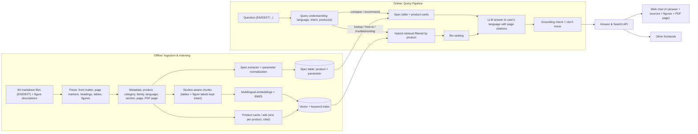
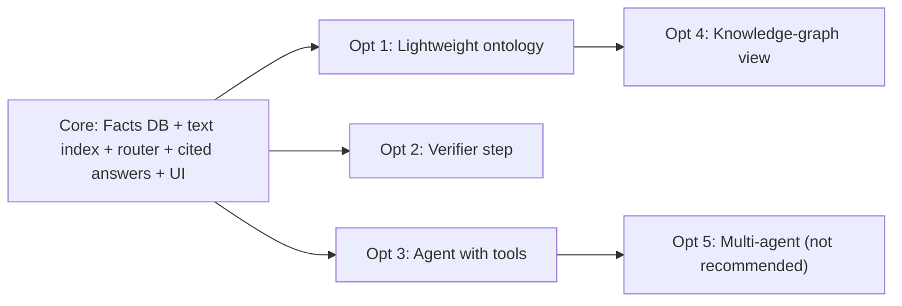

# System Overview: Conversational Access to Robot Documentation

> High-level design brief for the NOI Hackathon challenge (Telmekom).
> Sources: [1_project_slides.md](./1_project_slides.md), [data/PUDU-PDF-MD/README.md](./data/PUDU-PDF-MD/README.md)

---

## 1. The Challenge in One Sentence

Build a system where **anyone** (technician or salesperson/customer) can **ask a question in natural language** (EN / DE / IT) about **PUDU robots and accessories** and get an answer that is **accurate, clear, and traceable to the exact manual page**.

---

## 2. The Data We Have

### 2.1 At a glance

| | |
|---|---|
| Vendor | **PUDU Robotics** (Shenzhen Pudu Technology) — service robots |
| Documents | **22 user manuals**: 13 robots + 9 accessories |
| Languages | **EN, DE, IT** (FlashBot, GW1, Pager: EN + DE only) |
| Markdown files | **64** (`en.md` / `de.md` / `it.md` per manual) |
| Size | ~60k words in English (≈ 2–6k words per manual, SH1 is largest); ~3× that across all languages |
| Images | **476 PNG** figures, referenced from the markdown, with AI descriptions + printed labels |
| PDFs | 85: original multilingual PDF + one per-language PDF per manual |
| Doc type | Only **user manuals** (no separate datasheets/brochures) — specs live inside each manual |

### 2.2 Folder layout

```
data/PUDU-PDF-MD/
├── README.md
├── manuals/       13 robot manuals
└── accessories/   9 accessory manuals
    └── <manual>/
        ├── en.md  de.md  it.md     text per language  ← main corpus
        ├── en.pdf de.pdf it.pdf    per-language page PDFs (for citation/preview)
        ├── <manual>.pdf            original multilingual PDF
        └── images/                 figures, e.g. en-p003R-fig01.png
```

### 2.3 Product catalog

**Robots (13)**

| Family | Product | What it is (from manual) |
|---|---|---|
| Restaurant / hospitality delivery | **BellaBot** | Indoor delivery robot, cat-face design, voice, 4 trays, many modes (delivery, cruise, birthday…) |
| | **BellaBot Pro** | BellaBot + large 18.5" advertising screen, tray visual detection |
| | **KettyBot** / **KettyBot Pro** | Delivery + reception robot with big advertising screen, slim (55 cm passage) |
| | **PuduBot 2** | Delivery robot, 3 adjustable metal trays, 3D obstacle avoidance (restaurants, hotels, factories) |
| | **HolaBot** | Delivery robot focused on calling/notifications, high carrying capacity |
| | **SwiftBot** | Delivery robot, automatic door opening, laser projection, peak-period algorithms |
| | **FlashBot** | Enclosed-compartment delivery robot (doors), e.g. hotels/buildings |
| Industrial transport | **T300** | Heavy-load chassis robot, up to **300 kg** load |
| Cleaning | **CC1** / **CC1 Pro** | Commercial cleaning robot: sweep, scrub, vacuum, mop; auto fill/drain/charge |
| | **MT1** | Large-area sweeping robot (warehouses, factories) |
| | **SH1** | Compact upright scrubber-dryer (semi-manual, not fully autonomous) |

**Accessories (9)**

| Accessory | Belongs to |
|---|---|
| CC1 Charging Station, CC1 Docking Station | CC1 / CC1 Pro |
| CC1 Series Self-Cleaning Docking Station (Main) + (Base) | CC1 series |
| Mobile Water Station | CC1 series (water fill/drain) |
| MT1 Charging Station | MT1 |
| Charging Station Light | Delivery robots (compatibility table: FlashBot, T300, KettyBot/Pro, PuduBot 2, SwiftBot) |
| GW1 (gateway) + Pager (call button) | LoRa call system for delivery robots (e.g. HolaBot) |

### 2.4 Structure of each manual (very consistent)

1. Safety instructions (power, usage, environment)
2. Product components: overview, packing list, **appearance & labeled components**, **specifications table**
3. How to use: power on/off, mapping, buttons, modes, charging, indicator lights
4. Maintenance / troubleshooting (often tables: *problem → solution*)
5. After-sales / warranty
6. Compliance (FCC, IC, EU, disposal)

### 2.5 Markdown format features we can exploit

| Feature | Example | Use for |
|---|---|---|
| YAML front matter | `title`, `language`, `source_pdf`, `reference_pdf` | Product + language metadata |
| Page markers | `*Page 3 (PDF page 4, left)*` | **Page-level citations**, linking to the PDF page |
| Numbered headings | `## 2.4 Specifications` | Section-aware chunking, section citations |
| Spec tables | `\| Battery capacity \| 25.6 Ah \|` | Structured spec extraction (metric only) |
| Figure + AI description | `> *Figure description (AI): …*` | Searchable image context (flag as *not from PDF*) |
| Labels list | `- **5** Lidar` | Component questions ("where is the lidar?") |
| Image file names | `en-p003R-fig01.png` | Show figures in answers |

---

## 3. Who We Build For

| | Technicians | Non-Technical Users (sales, customers) |
|---|---|---|
| Example | "What's the battery capacity of BellaBot Pro?" → 25.6 Ah | "Which robot fits a restaurant with narrow aisles?" |
| | "CC1 charging station shows flashing yellow, why?" | "Which robot can carry 200 kg in a factory?" |
| | "Which power adapter is recommended for T300 on the Charging Station Light?" | "What's the difference between BellaBot and BellaBot Pro?" |
| Needs | Exact value + unit + page citation | Plain language, comparison, justified recommendation |

---

## 4. Requirements

**Must-haves (judged):** grounded & faithful answers · defensible architecture · at least one working interface.
**Judging:** answer quality · ease of use · faithfulness to source.
**Bonus:** (1) retrieval engine exposed via API for any frontend; (2) multilingual Q&A — naturally fits our EN/DE/IT data.

---

## 5. High-Level Architecture



### Components

| # | Component | Responsibility |
|---|---|---|
| 1 | **Parser** | Read YAML header, split by page markers and headings, keep tables/figure blocks whole; record page + PDF page for each block. |
| 2 | **Product registry** | Hand-made map: folder → product name, aliases ("Bella", "Ketty Pro"), category (delivery / cleaning / industrial / accessory), related products (accessory ↔ robot). |
| 3 | **Chunking** | One chunk ≈ one subsection; spec tables and troubleshooting tables as their own chunks; prepend context (`BellaBot Pro › 2.4 Specifications`). |
| 4 | **Index** | Multilingual embeddings (all 3 languages or EN-only + cross-lingual queries) + BM25 for exact terms (model names, "IP20", "LoRa"). |
| 5 | **Spec table** | Parse all spec tables into `product, parameter, value, unit, page`, with a synonym map for parameter names. Powers comparisons & recommendations. |
| 6 | **Product cards (LLM-wiki)** | Short cited summary per product (purpose, use cases, key specs, accessories) for non-technical questions. |
| 7 | **Query understanding** | Detect language, intent, and referenced products; ask for clarification if the product is ambiguous. |
| 8 | **Retrieval + re-ranking** | Hybrid search with product filter; cross-encoder/LLM re-rank. |
| 9 | **Generation** | Answer only from evidence, in the user's language, with `[Product, §section, p. N]` citations; technical vs. plain style. |
| 10 | **Guardrails** | Claim-support check; "not in the documentation" fallback; mark AI-figure descriptions as lower-confidence. |
| 11 | **API** | `POST /ask`, `POST /search`, `GET /products`, `GET /specs?product=` (Bonus 1). |
| 12 | **UI** | Chat + source cards that open the PDF page (`en.pdf`) and show figures. |

---

## 6. Problems We Have to Tackle (data-specific)

### A. Data & ingestion
- **Inconsistent spec parameter names** — same concept, different labels:
  - battery life = *Battery life* / *Runtime* / *Operation time of batteries*
  - passage width = *Min. travel width* / *Min. path clearance* / *Minimum passing width*
  - weight = *Robot weight* / *Weight* / *Overall weight* / *Product weight*
  → need a **parameter normalization map** for comparisons.
- **Repeated row labels** — merged cells are repeated (e.g. 5× *Frequency band range*); rows must be read together.
- **Inconsistent headings** — some manuals miss numbering levels, duplicate headings (`4.1` twice), merged headings (`# 2. Product Components 2.1 Overview`), typos (`Seires`).
- **Boilerplate noise** — copyright, FCC/IC compliance, warranty text repeated in all 22 manuals; can drown retrieval → down-weight or tag as `compliance`.
- **Two-pages-per-sheet PDFs** — printed page ≠ PDF page; keep both for correct citations.
- **AI-generated figure descriptions** are *not* part of the PDF → useful for search, but must not be cited as official facts.
- **Values with units in free text** (`0.2–1.2 m/s (adjustable)`, `10 kg/layer`) → parse carefully for numeric filters.

### B. Retrieval
- **Near-identical products** — BellaBot vs. BellaBot Pro, KettyBot vs. KettyBot Pro, CC1 vs. CC1 Pro share most text but differ in key specs → **strict product filtering** is essential, otherwise wrong-model answers.
- **Accessory ↔ robot relationships** — "How do I charge the CC1?" spans the robot manual *and* 4 accessory manuals.
- **Cross-product questions** — "Which robot…" needs data from all 13 manuals, not top-k chunks → use the spec table / product cards.
- **Three parallel language versions** — the same content exists 3×; avoid returning duplicates, and decide whether to index all languages or one.
- **Cross-lingual** — German question on FlashBot is fine (DE exists), Italian question on FlashBot must use EN/DE sources.

### C. Answer generation
- **Hallucination** — especially for recommendations; the LLM must not add general knowledge about PUDU robots.
- **Citations** to manual + section + page (+ PDF page link).
- **Missing info** — manuals contain no prices, no availability, little about software/app features → answer "not in the documentation".
- **Fuzzy needs → spec constraints** — "narrow aisles" → min. travel width; "heavy loads" → max. load; "outdoor" → IP rating/surface requirement.
- **Safety-relevant answers** — safety instructions and troubleshooting must be reproduced faithfully, not paraphrased loosely.
- **Units & language** — metric only in source; answer terminology should match the user's language.

### D. Product & UX
- Simple chat, example questions per user type, language selector or auto-detect.
- Source cards with page link and figures (we have the images and per-language PDFs).
- Conversation memory ("and how long does *it* take to charge?").

### E. Evaluation
- Build a test set (~30–50 Qs) covering: spec lookups, procedures, troubleshooting tables, comparisons, recommendations, accessory compatibility, DE/IT questions, unanswerable questions.
- Can be partly auto-generated from spec tables (ground-truth values known) and translated into DE/IT.
- Metrics: answer correctness, faithfulness, retrieval hit@k, correct product rate.

---

## 7. Architecture Options

| Option | Fit with this data | Verdict |
|---|---|---|
| **Classic RAG** | Works well for lookups/how-to; corpus is small and well-structured | Baseline |
| **LLM-generated wiki / product cards** | Small catalog (22 products) → cheap to generate and review | Great for non-technical users |
| **Structured spec DB** | Every manual has a spec table → easy to extract | Best for comparisons & recommendations |
| **Hybrid (recommended)** | RAG + spec table + product cards, routed by intent | Strongest story for quality + faithfulness |
| **Long-context "stuff it all"** | One manual ≈ 3–8k tokens; whole EN corpus ≈ 80k tokens — fits in big-context LLMs | Good fallback / comparison baseline; weaker on citations and cost |

---

## 8. Suggested Build Plan

1. **Parser + product registry** — markdown → blocks with product/lang/section/page metadata.
2. **MVP RAG** — hybrid index, product filter, cited answers.
3. **Web chat UI** with source cards (required deliverable — early).
4. **API separation** (`/ask`, `/search`) — Bonus 1.
5. **Spec table + normalization + product cards** — comparisons & recommendations.
6. **Multilingual** — multilingual embeddings, answer in user's language, fall back across languages — Bonus 2.
7. **Evaluation set + demo script** for the judges.

---

## 8b. Optional Extensions (only if time allows)

> [!NOTE]
> The core system (steps 1–7 above) must work end-to-end first. Each extension below is **independent and additive**: it can be added or skipped without breaking the core. Ordered by value ÷ effort.



| # | Extension | Value | Effort | Depends on |
|---|---|---|---|---|
| 1 | Lightweight ontology | High | Low–Medium | Facts DB |
| 2 | Verifier (self-check) step | High (faithfulness) | Low | Answer generator |
| 3 | Single agent with tools (replaces the hand-written router) | Medium–High | Medium | Facts DB API + search API |
| 4 | Knowledge-graph view of the data | Medium (demo "wow") | Low–Medium | Facts DB (+ ontology) |
| 5 | Full multi-agent / graph DB / OWL | Low for this data | High | — |

### Opt 1 — Lightweight ontology (`ontology.yaml`)

**What:** one file that defines the system's vocabulary:
- **Classes:** `Robot > DeliveryRobot / CleaningRobot / IndustrialRobot`; `Accessory > ChargingStation / DockingStation / CallDevice / WaterStation`
- **Properties:** standard spec names with units, e.g. `min_passage_width [cm]`, `battery_runtime [h]`, `max_load [kg]`, `ip_rating`
- **Synonyms:** `battery_runtime` = Battery life / Runtime / Operation time of batteries
- **Multilingual labels:** EN / DE / IT label for every class and property
- **Concept mappings:** "narrow aisles" → `min_passage_width`; "heavy loads" → `max_load`; "wet floors" → `ip_rating`

**Why:** one source of truth for label mapping, the router's constraint extraction, and cross-language matching (Bonus 2). Gives you a clear vocabulary to defend to judges.
**Don't:** use full OWL/RDF or a reasoning engine; at this scale it costs a lot and adds nothing.
**Done when:** the importer uses the synonym map, and the router maps DE/IT/EN concepts to standard spec names.

### Opt 2 — Verifier step

**What:** after the answer is drafted, a second AI call checks each claim against the retrieved evidence. Unsupported claims are removed, or the system answers "not in the documentation".
**Why:** directly improves **faithfulness**, a judging criterion, for one extra call.
**Done when:** the eval set shows fewer unsupported claims, and the UI can show a "verified against sources" badge.

### Opt 3 — Single agent with tools

**What:** replace the hand-written intent router with one AI model that calls tools:
`get_specs(product)`, `compare(products, params)`, `filter_products(category, constraints)`, `get_compatibility(product)`, `search_docs(query, product, lang)`.
**Why:** handles mixed and multi-step questions naturally ("which adapter for T300 **and** how do I charge it?"). The tools are the same endpoints as the API (Bonus 1).
**Watch out:** limit to ~3 tool calls per question to keep answers fast; log every tool call so it can be debugged.
**Done when:** the agent beats or matches the router on the eval set, with acceptable speed (target < 5 s).

### Opt 4 — Knowledge-graph view

**What:** draw the existing relational tables as a graph (no separate graph DB):
```
(KettyBot Pro) -IS_A-> (DeliveryRobot)
(KettyBot Pro) -HAS_SPEC {55 cm, p.3}-> (min_passage_width)
(Charging Station Light) -COMPATIBLE_WITH {15 A, recommended}-> (T300)
(Pager) -CONNECTS_VIA-> (GW1) -CONNECTS_TO-> (LoRa robots)
```
**Why:** a strong visual for the demo; it shows *why* an answer was given (the path through the graph) and makes accessory ↔ robot relationships easy to see.
**How:** export nodes and edges from the DB into a JS graph library (e.g. vis-network / Cytoscape.js) in the UI, and highlight the nodes used in the current answer.
**Done when:** the UI has a "Knowledge map" tab that highlights the products and facts behind the current answer.

### Opt 5 — Full multi-agent / graph database (not recommended)

Only consider it if everything above is finished. Multiple agents (router, spec, docs, recommender, translator, verifier), a separate graph DB (Neo4j), or a graph built by an AI from the text (GraphRAG) add **latency, nondeterminism, and extraction errors** for a 22-product corpus. Opt 2 + Opt 3 already give ~90% of the benefit.

### Pitch if extensions are done

> *"An ontology-grounded hybrid retrieval system: an agent uses structured and text tools, checks its own answers against the source, and shows its reasoning on a knowledge map."*

---

## 9. Open Questions

- Are we restricted to specific LLM providers or must it run locally?
- Should answers be allowed to use the PDFs directly, or only the markdown?
- Is any hosting/deployment needed for the demo?
- Will judges test with their own questions (and in which languages)?
