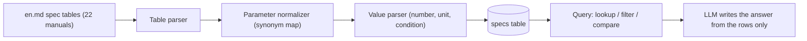
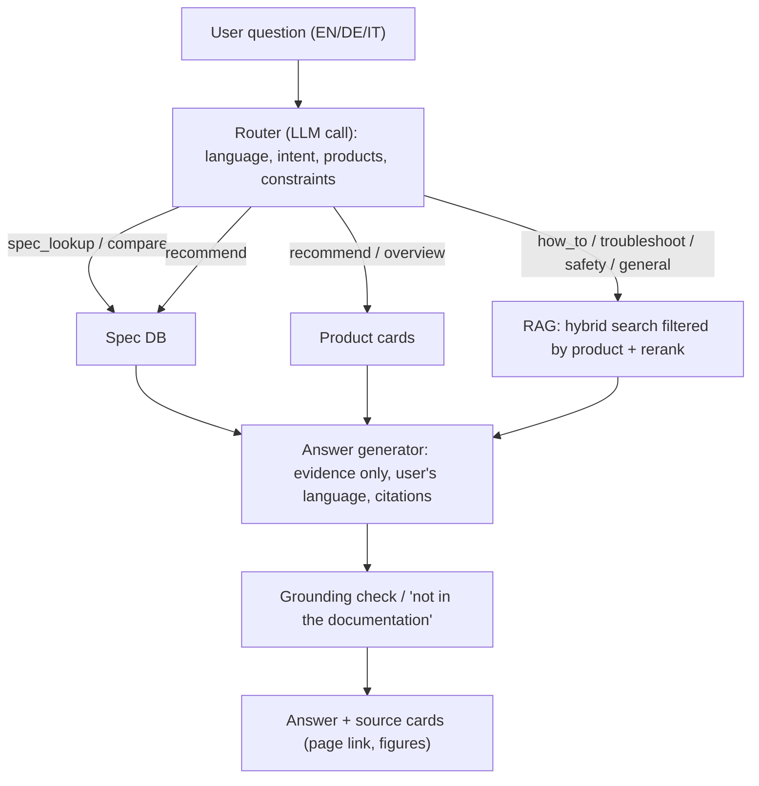

# Architecture Deep Dive: Structured Spec DB & Hybrid Routing

> Companion to [2_system_overview.md](./2_system_overview.md). All examples below use **real values** from `data/PUDU-PDF-MD`.

---

## Part 1 — Structured Spec DB

### 1.1 The idea in one sentence

Turn every manual's **specifications table** into rows of a database (`product × parameter → value`), so spec questions are answered by **looking up facts**, not by asking an LLM to find them in text.

### 1.2 Why this works with our data

Every one of the 13 robot manuals (and most accessory manuals) has a section like `## 2.4 Specifications` with a clean Markdown table:

```markdown
# 2.4 Specifications            ← BellaBot Pro, en.md, Page 3 (PDF page 4, left)
| Feature | Description |
|---|---|
| Battery capacity | 25.6 Ah |
| Charging time | 4.5 h |
| Battery life | 11 h (unloaded) |
| Min. travel width | 65 cm |
| Tray load | 10 kg/layer |
| IP rating | IP20 |
```

The information is already structured, so we only need to **extract it, not interpret it**.

### 1.3 How it works



**Step 1 — Parse tables** (simple code, no LLM): find the spec section, read each `| key | value |` row, remember product + page.

**Step 2 — Normalize parameter names.** The manuals use different labels for the same thing:

| Canonical parameter | Labels found in the manuals |
|---|---|
| `min_passage_width` | Min. travel width · Min. path clearance · Minimum passing width |
| `battery_runtime` | Battery life · Runtime · Operation time of batteries |
| `load_per_tray` | Tray load · Tray supporting capacity |
| `max_load` | Max. load · Load capacity |
| `weight` | Robot weight · Weight · Overall weight · Product weight |

A hand-written map of ~30 entries covers this (or an LLM proposes it once, a human checks it).

**Step 3 — Parse values.** Keep the raw text (for faithful quoting) **plus** numbers (for filtering):

| product | parameter | raw value (as printed) | min | max | unit | page |
|---|---|---|---|---|---|---|
| BellaBot Pro | battery_runtime | 11 h (unloaded) | 11 | 11 | h | 3 |
| BellaBot | battery_runtime | 12–24 h | 12 | 24 | h | … |
| T300 | battery_runtime | 12 h (None load); 6 h (Max. load) | 6 | 12 | h | … |
| T300 | max_load | 300 kg | 300 | 300 | kg | … |
| KettyBot Pro | min_passage_width | 55 cm | 55 | 55 | cm | … |
| SwiftBot | min_passage_width | 80 cm | 80 | 80 | cm | … |
| HolaBot | load_per_tray | Flat surface: 15 kg/layer; Obstacle crossing height of 5 mm: 10 kg/layer | 10 | 15 | kg | … |
| CC1 Pro | ip_rating | IPX4 | – | – | – | … |

Plus a small **product table**: `name, category (delivery / cleaning / industrial / accessory), aliases, manual folder`.

### 1.4 Real examples

**Example A — exact lookup (technician)**
> **Q:** "What's the battery life of the BellaBot Pro?"
> **Query:** `SELECT raw FROM specs WHERE product='BellaBot Pro' AND parameter='battery_runtime'`
> **A:** "**11 h** (unloaded). *[BellaBot Pro User Manual, §2.4 Specifications, p. 3]*"

**Example B — comparison**
> **Q:** "BellaBot vs BellaBot Pro, what's different?"
> Pull both products' rows, keep only the parameters that differ:

| Parameter | BellaBot | BellaBot Pro |
|---|---|---|
| Battery life | 12–24 h | 11 h (unloaded) |
| Min. travel width | 70 cm | 65 cm |
| Screen size | 10.1" LCD | 10.1" LCD + 18.5" advertising screen |

This is exactly where plain RAG often fails: both manuals use almost the same text, so retrieved chunks get mixed up.

**Example C — filter / ranking across all products**
> **Q:** "Which robot fits through the narrowest aisles?"
> `SELECT product, raw FROM specs WHERE parameter='min_passage_width' ORDER BY min ASC`
> → KettyBot / KettyBot Pro **55 cm**, T300 60 cm, BellaBot Pro 65 cm, … SwiftBot / PuduBot 2 80 cm.

Plain RAG cannot do this reliably: it would need all 13 spec tables in its top-k results.

### 1.5 Why it's a strong option

| Benefit | Why it matters for judging |
|---|---|
| **Numbers come from the DB, not from the LLM** → numeric values can't be hallucinated | Faithfulness |
| Comparisons and "which robot…" questions become simple queries | Answer quality for non-technical users |
| Every row stores product + page → exact citations | Faithfulness / trust |
| Values don't depend on language (55 cm is 55 cm) → works for DE/IT questions too | Bonus 2 |
| Easy to expose as an API (`GET /specs?product=…`) | Bonus 1 |
| Small: ~22 tables × ~30 rows ≈ 600 rows, so it's quick to build and check by hand | Hackathon-friendly |

### 1.6 Limitations (why it isn't enough on its own)

- It covers **only the spec tables** (maybe 10–15% of the content). It can't answer how-to, troubleshooting, safety, maintenance, or "what do the indicator lights mean".
- It needs a normalization step, plus care with conditional values ("6 h at max load").
- It knows numbers, not *use cases* ("good for hotels").

→ Combining it with other components fixes these gaps. That combination is the Hybrid below.

---

## Part 2 — Hybrid: RAG + Spec DB + Product Cards, Routed by Intent

### 2.1 The idea in one sentence

Use **three specialised knowledge sources**, each good at one kind of question, and a **router** that sends each question to the right one(s).

| Source | What it holds | Best for |
|---|---|---|
| **Spec DB** (Part 1) | Structured parameters per product | Lookups, comparisons, filters, recommendations |
| **RAG index** | All manual text in chunks (procedures, troubleshooting, safety, figures) | How-to, troubleshooting, "what does X mean" |
| **Product cards** (LLM-wiki) | One short, cited summary per product: purpose, scenarios, key specs, accessories | Non-technical "what is / which fits" questions |

### 2.2 How it works



**The router** is one small, cheap LLM call that returns JSON:

```json
{
  "language": "de",
  "intent": "recommend",
  "products": [],
  "category": "delivery",
  "constraints": [{"parameter": "min_passage_width", "op": "<=", "value": 60, "unit": "cm"}]
}
```

Intents: `spec_lookup`, `compare`, `recommend`, `overview`, `how_to`, `troubleshoot`, `safety`, `general`.
If a question needs more than one source (e.g. "how do I charge it and how long does it take?"), the router returns several and the results are merged.

**Product cards** are generated once, offline, from each manual and checked by us. Example (KettyBot Pro, built from its manual):

```markdown
## KettyBot Pro  (category: delivery & reception)
- What it is: delivery and reception robot with a large advertising screen,
  visual + laser SLAM navigation. [§2.1]
- Strength: fits through 55 cm passages, good in crowded spaces. [§2.4]
- Key specs: battery life 11 h (no-load), tray load 10 kg/layer, IP20. [§2.4]
- Compatible charging: Charging Station Light (8 A / 15 A adapter recommended). [Charging Station Light §3.2]
- Typical scenarios: restaurants, retail, reception/guiding.
```

### 2.3 Real examples, end to end

**Example 1 — Technician, spec lookup → Spec DB**
> **Q:** "Max load of the T300?"
> Router: `spec_lookup`, product `T300`, parameter `max_load`.
> **A:** "The T300 carries up to **300 kg**. Battery life is 12 h with no load and 6 h at max load. *[T300 User Manual, §Specifications]*"

**Example 2 — Technician, troubleshooting → RAG**
> **Q:** "Charging Station Light shows flashing yellow and won't charge."
> Router: `troubleshoot`, product `Charging Station Light` → RAG retrieves the §3.4 troubleshooting table row.
> **A:** "Flashing yellow means more than one power adapter is connected, or the adapter doesn't match the robot. Keep only one adapter connected and use the recommended one from §3.2 *Compatible Products List*. *[Charging Station Light Manual, §3.4]*"

The Spec DB couldn't answer this. RAG can.

**Example 3 — Non-technical, German, recommendation → Spec DB + Product cards**
> **Q:** "Welcher Roboter passt für ein Restaurant mit engen Gängen von etwa 60 cm?"
> Router: `recommend`, language `de`, category `delivery`, constraint `min_passage_width ≤ 60 cm`.
> Spec DB filter → **KettyBot (55 cm), KettyBot Pro (55 cm)**. (T300 is 60 cm but `industrial`, so it's excluded.)
> Product cards → explain what KettyBot is for.
> **A (in German):** "Für Gänge um 60 cm eignen sich **KettyBot** und **KettyBot Pro**: beide benötigen nur 55 cm Durchfahrtsbreite. Sie sind Liefer- und Empfangsroboter mit großem Werbebildschirm … Die meisten anderen Lieferroboter (BellaBot 70 cm, SwiftBot 80 cm) brauchen breitere Gänge. *[KettyBot Pro Handbuch, §2.4]*"

The question is in German, the facts come from structured data, and the citation points to the German manual, all without hallucinating.

**Example 4 — Mixed question → Spec DB + RAG**
> **Q:** "Which adapter should I use to charge the T300 on the Charging Station Light, and how do I start charging?"
> Router: `spec_lookup` (compatibility table) + `how_to` (charging procedure).
> **A:** "Use the **15 A adapter** (recommended; 3.5 A and 8 A are compatible but slower) *[Charging Station Light §3.2]*. To charge: … *[T300 Manual §Charging]*"

### 2.4 Why it's the recommended option

1. **It matches the question types.** The challenge names two users: technicians ask lookups and how-to questions, non-technical users ask comparisons and recommendations. Each gets the tool built for it.
2. **It fixes RAG's known weak spots on this data:**
   - near-identical products (BellaBot vs Pro) → the Spec DB keeps them in separate rows
   - "which robot…" across 13 manuals → a DB query instead of top-k luck
   - numeric hallucinations → numbers come from rows
3. **It fixes the Spec DB's weak spots:** procedures, troubleshooting, safety and figures stay covered by RAG.
4. **It's easy to defend:** "We route each question to the most reliable source, and every claim has a citation." Judges can follow it.
5. **The bonuses come almost free:** each source is a separate service (`/specs`, `/search`, `/products`, `/ask`), which is Bonus 1. The router detects language and the facts don't depend on language, which is Bonus 2.
6. **It's feasible in a hackathon:** the corpus is small (22 manuals, ~600 spec rows, 22 cards), and every component is simple on its own.

### 2.5 Costs & risks

| Risk | Mitigation |
|---|---|
| Router picks the wrong intent | Fall back to RAG when unsure. Log routing decisions and test them on the eval set. |
| More moving parts than plain RAG | Build in order: RAG first (works alone), then Spec DB, then cards and the router. |
| Product cards could contain LLM mistakes | Generate them with citations and check all 22 by hand (small number). |
| Normalization map is incomplete | Unmapped parameters stay searchable through RAG. |

### 2.6 Side-by-side on the same questions

| Question | Plain RAG | Spec DB only | Hybrid |
|---|---|---|---|
| "BellaBot Pro battery life?" | ⚠️ may return BellaBot's 12–24 h | ✅ 11 h | ✅ 11 h |
| "Narrowest robot?" | ❌ needs all 13 tables in top-k | ✅ KettyBot 55 cm | ✅ + explanation |
| "Flashing yellow light?" | ✅ | ❌ no data | ✅ |
| "Robot for 60 cm restaurant aisles?" (DE) | ⚠️ vague | ⚠️ numbers only, no context | ✅ filtered + explained |
| "How do I map the BellaBot Pro?" | ✅ | ❌ | ✅ |
