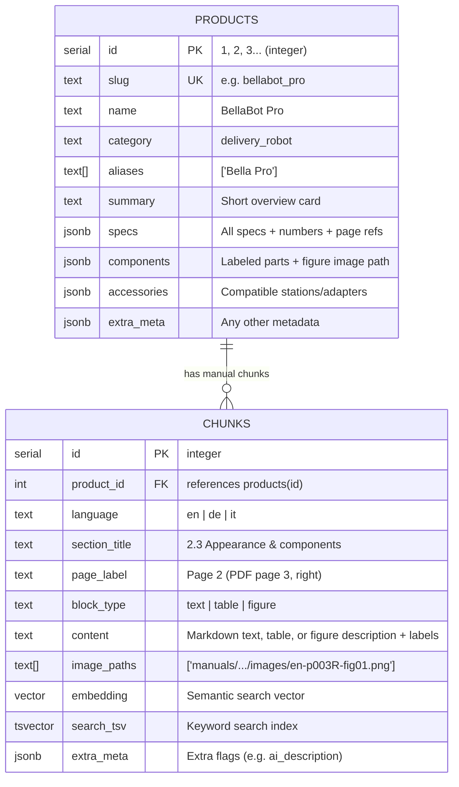
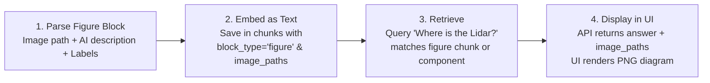
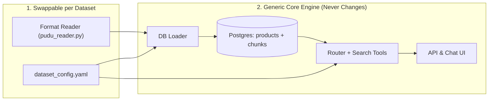

# Database Schema & Generalizable Design

> Companion to [2_system_overview.md](./2_system_overview.md) and [3_architecture_deep_dive.md](./3_architecture_deep_dive.md).
> A simple, clean architecture using **PostgreSQL (`JSONB` + `pgvector`)** that stores **one row per product**, handles **images/diagrams**, avoids data repetition, and works on any dataset without changing the database schema.

---

## 1. Core Idea: One Unified Database (Postgres `JSONB` + `pgvector`)

Instead of managing a NoSQL database *and* a separate Vector database—or spreading one product across dozens of rows—we use **one PostgreSQL database** with **two tables**:

1. **`products` (Structured Facts — NoSQL style via `JSONB`):**
   **One row per product** (22 rows total for PUDU) with an integer `id`. All specifications, labeled diagram components, and compatible accessories live inside `JSONB` columns on that single row.
2. **`chunks` (Full Text + Figures + Vectors — RAG style via `pgvector`):**
   Every manual section, procedure, troubleshooting table, and figure (with its image path, AI description, and printed labels), indexed for both **vector search** (`pgvector`) and **keyword search** (`tsvector`).

---

## 2. The 2-Table Database Schema



### SQL Definition

```sql
-- Table 1: One row per product (NoSQL document style inside Postgres)
CREATE TABLE products (
    id SERIAL PRIMARY KEY,            -- 1, 2, 3... (clean integer PK)
    slug TEXT UNIQUE NOT NULL,        -- 'bellabot_pro' (for readable URLs/API)
    name TEXT NOT NULL,               -- 'BellaBot Pro'
    category TEXT NOT NULL,           -- 'delivery_robot'
    aliases TEXT[] DEFAULT '{}',      -- ARRAY['Bella Pro']
    summary TEXT,                     -- Short product overview card
    specs JSONB NOT NULL DEFAULT '{}',-- All specifications in one JSON object
    components JSONB DEFAULT '[]',    -- Labeled parts + image paths
    accessories JSONB DEFAULT '[]',   -- Compatible accessories / adapters
    extra_meta JSONB DEFAULT '{}'     -- Extra unpredictable fields
);

-- Table 2: Manual chunks & figures for hybrid RAG (Vector + Keyword search)
CREATE TABLE chunks (
    id SERIAL PRIMARY KEY,
    product_id INT REFERENCES products(id) ON DELETE CASCADE,
    language TEXT NOT NULL,           -- 'en', 'de', 'it'
    section_title TEXT,               -- '2.3 Appearance & components'
    page_label TEXT,                  -- 'Page 2 (PDF page 3, right)'
    block_type TEXT,                  -- 'text', 'table', 'figure'
    content TEXT NOT NULL,            -- Text, table, or figure transcription
    image_paths TEXT[] DEFAULT '{}',  -- Paths to PNGs in this chunk/section
    embedding VECTOR(1536),           -- pgvector for semantic search
    search_tsv TSVECTOR,              -- Full-text keyword search
    extra_meta JSONB DEFAULT '{}'     -- Extra metadata
);
```

---

## 3. What a Single Row in `products` Looks Like

Every product has different specifications (`BellaBot Pro` has `tray_load`; `CC1 Pro` has `water_tank_capacity`). Because `specs` is a `JSONB` object, each product stores only the fields it needs—with **no empty columns** and **no repeated rows**.

To keep **exact numeric filtering** and **page citations**, each spec stores both the raw string and parsed numbers:

```json
{
  "id": 1,
  "slug": "bellabot_pro",
  "name": "BellaBot Pro",
  "category": "delivery_robot",
  "aliases": ["Bella Pro"],
  "summary": "Indoor delivery robot with 4 trays, 18.5-inch ad screen, and visual tray detection.",
  "specs": {
    "battery_runtime": {
      "raw": "11 h (unloaded)",
      "min": 11,
      "max": 11,
      "unit": "h",
      "original_label": "Battery life",
      "page": "Page 3 (PDF page 4, left)"
    },
    "min_passage_width": {
      "raw": "65 cm",
      "min": 65,
      "max": 65,
      "unit": "cm",
      "original_label": "Min. travel width",
      "page": "Page 3 (PDF page 4, left)"
    },
    "tray_load": {
      "raw": "10 kg/layer",
      "min": 10,
      "max": 10,
      "unit": "kg",
      "page": "Page 3 (PDF page 4, left)"
    },
    "ip_rating": {
      "raw": "IP20",
      "page": "Page 3 (PDF page 4, left)"
    }
  },
  "components": [
    {
      "number": 1,
      "name": "Power switch",
      "page": "Page 2 (PDF page 3, right)",
      "image_path": "manuals/BellaBot_Pro_User_Manual-multilanguage/images/en-p003R-fig01.png"
    }
  ],
  "accessories": [
    { "product_slug": "charging_station_light", "note": "Standard charger", "page": "Page 4" }
  ]
}
```

---

## 4. How Images Are Handled in Our RAG System

The dataset contains **476 PNG figures**. Inside the Markdown files, every image is already paired with an **AI description** and **printed callout labels**:

```markdown

> *Figure description (AI):* The figure identifies key components of the PUDU T300 robot using numbered labels.
*Labels:*
- **1** Indicator light
- **2** LCD screen
- **5** Lidar
```

We embed and return images using a simple 4-step pipeline:



1. **Ingestion (`image_paths` column):**
   - When the parser sees a figure block (`` + description + `*Labels:*`), it creates a chunk (`block_type = 'figure'`), puts the description and labels into `content`, and saves the relative PNG path in `image_paths`.
   - When a how-to section (e.g., *"3.1 Mapping instructions"*) contains inline step-by-step screenshots, those image paths are also attached to that section's text chunk in `image_paths`.
2. **Embedding:**
   Because every figure already has a rich text transcription (heading + AI description + numbered labels), we embed that text with the **same text embedding model** used for regular chunks.
3. **Retrieval (RAG + Structured):**
   - If the user asks *"Where is the Lidar on the T300?"* or *"Show me how to clean the CC1 water tank"*, hybrid search retrieves the matching chunk along with its `image_paths`.
   - Component diagrams are also stored in `products.components`, so structured lookups also return the exact diagram path.
4. **Serving to the User Interface:**
   - The backend exposes the `data/PUDU-PDF-MD` folder as static files (e.g., `/static/manuals/.../images/en-p003R-fig01.png`).
   - Whenever the LLM cites a chunk (or component) that has `image_paths`, the API includes those image URLs in the response so the Chat UI displays the diagram right below the answer.

---

## 5. How We Keep the System Generalizable to Any Dataset

To make sure our system works if the file format changes—or if we reuse it on a totally different dataset (e.g., coffee machines or medical devices)—we separate **dataset-specific input** from the **generic core engine**:



### The Only 2 Files That Know About PUDU Robots

1. **The Format Reader (`pudu_reader.py`):**
   Reads the PUDU folders/Markdown files and outputs standard dictionaries (`product`, `page`, `section`, `block_type`, `content`, `image_paths`).
   - *If the file format changes tomorrow (e.g., to raw PDFs or HTML):* we only replace this reader script.
2. **The Domain Config (`dataset_config.yaml`):**
   Lists the product categories and maps different spec labels to a single standard key so products can be compared:
   ```yaml
   domain_name: "PUDU Service Robots"
   categories: [delivery_robot, cleaning_robot, industrial_robot, accessory]

   spec_synonyms:
     min_passage_width: ["Min. travel width", "Min. path clearance", "Minimum passing width"]
     battery_runtime:   ["Battery life", "Runtime", "Operation time of batteries"]
     max_load:          ["Max. load", "Load capacity"]
   ```
   *(Any spec in a manual that isn't in `spec_synonyms` is still saved automatically in `specs` using its own name, so nothing is ever lost.)*

### What Changes If We Switch to a New Dataset?

| Component | Changes needed |
|---|---|
| **Postgres Schema (`products`, `chunks`)** | **None (0%)** — `specs` is `JSONB`, so any new product attributes fit automatically. |
| **Router, Search Tools, API & UI** | **None (0%)** — they query `products`, `chunks`, and `image_paths` generically. |
| **`dataset_config.yaml`** | Update categories and synonym list (~20 lines). |
| **Format Reader** | Reuse if Markdown, or plug in a new reader if the file format is different. |
