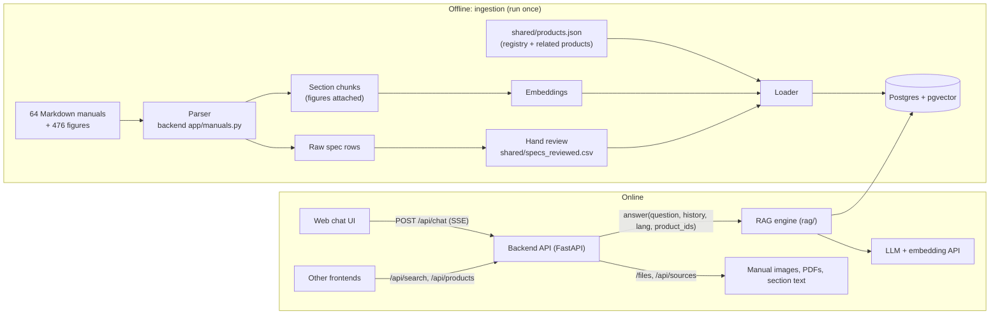
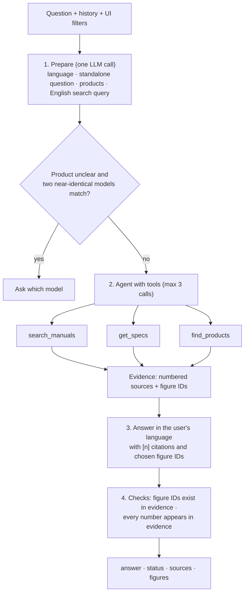
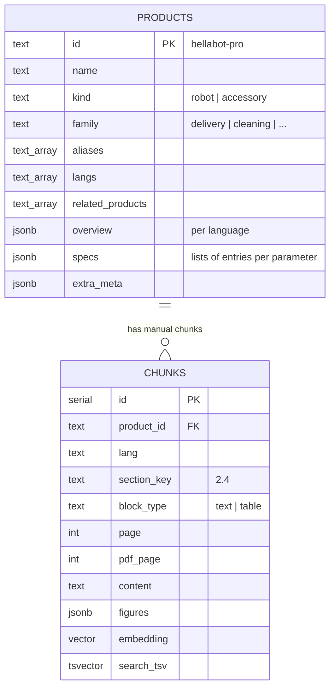

# Project Plan: Conversational Access to PUDU Robot Documentations

> Single reference for what we build, how it is structured and in which order.
> It merges four inputs:
> - the design docs [2](./2_system_overview.md), [3](./3_architecture_deep_dive.md), [4](./4_database_and_generalizability.md)
> - the review in [5_review_feedback.md](./5_review_feedback.md)
> - the FastAPI backend on the `backend-api` branch
> - the reference repo [Document-Processing-RAG-System](https://github.com/azamafridi23/Document-Processing-RAG-System) (read, not run)
>
> Written Sat 14 Nov, night. Code freeze is **Sat 14:05**, hand-in **15:00**.

---

## 1. What we are building

A chat assistant where a technician or a salesperson asks a question in English, German or Italian about 22 PUDU products and gets:

1. an answer taken only from the manuals,
2. numbered citations that open the manual section and page,
3. the figure from the manual when the question is about a part or a procedure step.

Judging criteria and how we meet them:

| Criterion | How |
|---|---|
| Answer quality | Product routing before retrieval; checked spec values for comparisons |
| Faithfulness to the source | Every claim cites a section; numbers are copied, not generated; "not in the documentation" when nothing is found |
| Ease of use | One chat screen, example questions, sources and figures next to the answer |
| Bonus 1: plug-and-play retrieval | The backend API is separate from the UI and from the RAG engine |
| Bonus 2: multilingual | Manuals indexed in EN / DE / IT; answer in the user's language |

---

## 2. Decisions

| # | Decision | Why |
|---|---|---|
| D1 | **PostgreSQL + pgvector**, started with Docker Compose | Already chosen in doc 4, and the reference repo gives working code for it. A seed dump is committed so the demo does not depend on re-running ingestion |
| D2 | **Two tables**: `products` and `chunks`, as in doc 4 | One row per product with its specs as JSON; a new product or a new spec needs no schema change. The JSON shape is changed so that no value is lost (section 4.2) |
| D3 | **One section = one chunk**, using the backend's parser | Tables and procedures stay whole; section keys match the backend's citation links |
| D4 | **Route to the product first, then search** | The reference repo selects relevant files before searching. Here it removes the BellaBot / BellaBot Pro mix-up |
| D5 | **Tool-calling agent with 3 tools, max 3 calls** | Same pattern as the reference repo's agent; handles mixed questions without a hand-written router |
| D6 | **Figures travel with the chunk as data; the model picks figure IDs** | Reference repo pattern (`image_data` in metadata), plus a server-side check |
| D7 | **The backend on `backend-api` is the only API**; the RAG plugs in with `RAG_ENGINE=python` | It already serves products, sources, files, search and chat |
| D8 | **One product registry and one spec mapping**, both under `shared/` | Today doc 4 and the backend each have their own |
| D9 | **No compatibility table.** Each product lists its `related_products`, and their manuals are searched together | "Which adapter for the T300?" names the robot, but the answer is in the Charging Station Light manual |

---

## 3. Architecture

### 3.1 Overview



Three layers, each replaceable:

| Layer | Folder | Responsibility |
|---|---|---|
| **UI** | `frontend/` | Chat, source cards, figures with legend, product list and compare |
| **Backend API** | `backend/` | HTTP contract, streaming, product catalog, citation links, static files, feedback |
| **RAG engine** | `rag/` | Question understanding, retrieval, tools, answer generation, checks |
| **Ingestion** | `ingest/` | Markdown → database |
| **Shared data** | `shared/` | Product registry (with related products), spec label mapping, reviewed specs |

### 3.2 Answering a question (inside the RAG engine)



**Step 1: Prepare.** One structured LLM call returns:

```json
{"language": "de", "question": "Which robot fits a restaurant with 60 cm aisles?",
 "product_ids": [], "family": "delivery", "search_query": "minimum passage width narrow aisles"}
```

Products are matched first by alias in code (`shared/products.json`), and the LLM result is used only when no alias matches. Product filters chosen in the UI always win.

**Related products.** After matching, the list is extended with each product's `related_products` (T300 → Charging Station Light; CC1 → its four stations). Accessory questions asked from the robot's side then reach the accessory manual, where the compatibility list and the charging instructions are printed.

**Step 2: Tools.**

| Tool | Reads | Used for |
|---|---|---|
| `search_manuals(query, product_ids, lang)` | `chunks` | How-to, troubleshooting, safety, indicators, "where is…", accessory compatibility. With 1–2 products it returns **all sections** of those manuals (3–8k tokens each), without boilerplate, plus the top sections of their related products. With no product it runs vector + keyword search and returns the top 8 |
| `get_specs(product_ids, parameters)` | `products.specs` | Exact values and side-by-side comparison |
| `find_products(parameter, op, value, family)` | `products.specs` (reviewed entries only) | "Which robot…" filters and rankings. It loads the 22 rows and filters in Python |

Each tool result is a list of sources in one format (section 5.2), so the answer step treats them all the same.

**Step 3: Answer.** The prompt allows only the evidence, requires a `[n]` after each claim, requires spec values to be copied as printed, and asks for a JSON result with `answer`, `status` and `figure_ids`.

**Step 4: Checks** (code, no extra LLM call). Unknown figure IDs are dropped. If a number in the answer does not appear in any evidence text, the answer is regenerated once; if it still fails, the status becomes `not_in_docs`.

### 3.3 What we take from the reference repo

| From the reference repo | Use | Change |
|---|---|---|
| pgvector store with JSON metadata (`pg_vector.py`) | **Reuse** | Our own `chunks` table with real columns for filters (section 4) |
| Tool-calling agent with a search tool (`agent_service2.py`) | **Reuse** | Three tools instead of one; history comes from the backend |
| LLM query rewriting before search | **Reuse** | Merged into the Prepare call; also translates the query to English |
| File-level selection, then load all chunks of those files | **Reuse as product routing** | Alias match first, LLM second; 22 products instead of a file list |
| Image paths + descriptions passed to the model as "Associated Images" | **Reuse** | Figure IDs instead of paths, checked by the server; labels included |
| Ragas evaluation script (`rag_ragas.py`) | **Reuse** | Our own 20 questions |
| Streamlit chat app | **Fallback UI only** | Plan B if the web UI is late |
| One embedding per document, built from an LLM summary | **Do not use** | Answers would come from a summary, with no page to cite |
| Vision model describing every image | **Do not use** | The dataset already has descriptions and printed labels |
| `RecursiveCharacterTextSplitter` (1000 / 200) | **Do not use** | Cuts tables and procedures in the middle |
| GPT reranking of 20 chunks | **Do not use** | Several seconds per question; product filtering does the job |
| S3, Celery, Redis, Google Drive, Gmail, Twilio | **Do not use** | Not needed; images are served by the backend |

---

## 4. Database design

### 4.1 Tables



```sql
CREATE EXTENSION IF NOT EXISTS vector;

-- 22 rows: one per product. Registry fields come from shared/products.json
CREATE TABLE products (
    id               TEXT PRIMARY KEY,         -- same ID as the backend: 'bellabot-pro'
    name             TEXT NOT NULL,            -- 'BellaBot Pro'
    kind             TEXT NOT NULL,            -- robot | accessory
    family           TEXT NOT NULL,            -- delivery | cleaning | industrial | charging | docking | call_system | water
    aliases          TEXT[] DEFAULT '{}',      -- 'Bella Pro', 'CCBC02', 'SWFD11', 'FlashBot New'
    langs            TEXT[] NOT NULL,          -- {en,de,it} or {en,de}
    folder           TEXT NOT NULL,            -- manual folder (the only reliable product key)
    related_products TEXT[] DEFAULT '{}',      -- robot <-> accessory links, both directions
    overview         JSONB DEFAULT '{}',       -- {"en": "...", "de": "..."}: first overview paragraph, quoted
    specs            JSONB NOT NULL DEFAULT '{}',  -- see 4.2
    extra_meta       JSONB DEFAULT '{}'
);

-- About 1,000 rows: one per numbered section, per language
CREATE TABLE chunks (
    id            SERIAL PRIMARY KEY,
    product_id    TEXT NOT NULL REFERENCES products(id) ON DELETE CASCADE,
    lang          TEXT NOT NULL,         -- en | de | it
    section_key   TEXT NOT NULL,         -- backend key: '2.4', '5.1~2', '0'
    section_title TEXT,
    section_kind  TEXT,                  -- safety | overview | components | specs | usage | maintenance | troubleshooting | compliance | warranty
    block_type    TEXT NOT NULL,         -- text | table
    seq           INT NOT NULL,          -- order inside the manual
    page          INT,                   -- printed page
    pdf_page      INT,                   -- page in the original multilingual PDF
    content       TEXT NOT NULL,         -- raw section text, including figure descriptions and label lists
    figures       JSONB DEFAULT '[]',    -- see 4.3
    embedding     VECTOR(1536),          -- set to the dimension of the chosen model
    search_tsv    TSVECTOR               -- to_tsvector('simple', content)
);
CREATE INDEX ON chunks (product_id, lang);
CREATE INDEX ON chunks USING GIN (search_tsv);
```

Changes compared to doc 4:

| Change | Why |
|---|---|
| `id` is the text ID from `shared/products.json`, not an integer | The backend already uses these IDs in every URL |
| `related_products` replaces `accessories` | A link is enough: the compatibility list itself is a table in the accessory manual and is found by search, with its citation |
| `components` removed | The same labels are in the section text and in `chunks.figures`, in all three languages |
| No separate rows for figures (`block_type = 'figure'` in doc 4) | A section has at most 3 figures, and their descriptions and labels are already in the section text. One section = one row |
| `summary` → `overview` per language | Quoted from the manual, not written by an LLM |
| `specs` holds **lists** of entries | See 4.2 |
| `chunks`: `section_key`, `seq`, `page`, `pdf_page` instead of `page_label` | Needed to build citation links and to keep sections in order |
| `chunks.figures` instead of `image_paths` | Carries the labels and an ID the server can check |

### 4.2 The `specs` field

A new product, or a product with different specifications, needs no schema change: it is a new row with whatever keys it has.

Each key holds a **list of entries**, because one parameter can have several printed values:

```json
{
  "min_passage_width": [
    {"raw": "65 cm", "label": "Min. travel width",
     "op": "=", "min": 65, "max": 65, "unit": "cm",
     "page": 3, "pdf_page": 4, "reviewed": true}
  ],
  "battery_runtime": [
    {"raw": "12 h (None load)", "label": "Battery life", "condition": "no load",
     "op": "=", "min": 12, "max": 12, "unit": "h", "page": 3, "pdf_page": 4, "reviewed": true},
    {"raw": "6 h (Max. load)", "label": "Battery life", "condition": "max. load",
     "op": "=", "min": 6, "max": 6, "unit": "h", "page": 3, "pdf_page": 4, "reviewed": true}
  ],
  "weight": [
    {"raw": "65 kg (WTID01)", "label": "Overall weight", "variant": "WTID01",
     "op": "=", "min": 65, "max": 65, "unit": "kg", "page": 3, "pdf_page": 4, "reviewed": true},
    {"raw": "81 kg (WTIDL1)", "label": "Overall weight", "variant": "WTIDL1",
     "op": "=", "min": 81, "max": 81, "unit": "kg", "page": 3, "pdf_page": 4, "reviewed": true}
  ],
  "_unmapped": [
    {"raw": "Bluetooth: 2402–2480 MHz", "label": "Frequency band range", "page": 3, "pdf_page": 4}
  ]
}
```

| Field | Meaning |
|---|---|
| `raw`, `label` | Value and label exactly as printed. The answer quotes `raw` |
| `variant` | Model or option the value applies to (`SWFD11`, `15 A adapter`, `ECO mode`) |
| `condition` | Printed condition (`unloaded`, `from 0% to 90%`) |
| `op` | `=`, `<`, `>`, `>=`, `~` for values like `< 3 h`, `> 8 h`, `About 2 h` |
| `min`, `max`, `unit` | Numbers converted to **one unit per parameter** (cm, kg, h), so products can be compared |
| `page`, `pdf_page` | Integers, for the citation link |
| `reviewed` | `true` when a person checked the entry against the manual. Filters and rankings use only these |
| `_unmapped` | Rows whose label is not in the mapping. Kept as a list, so repeated labels do not overwrite each other |

"Which robot…" questions: `find_products` loads the 22 rows and filters the entries in Python. No JSON SQL is needed at this size.

### 4.3 The `figures` field

Stored on the chunk of the section where the figure appears:

```json
[
  {"id": "bellabot-pro:en:p003R-fig01",
   "path": "images/en-p003R-fig01.png",
   "caption": "2.3 Appearance & components",
   "labels": [{"n": "1", "text": "LCD screen"}, {"n": "20", "text": "Emergency stop switch"}],
   "has_ai_description": true}
]
```

`labels` are printed in the PDF and can be cited. The AI description is part of the section's `content`, where the manual text marks it as AI-written; it helps search and is not quoted as a fact.

### 4.4 What goes into `content` and into the embedding

| Chunk | `content` (stored, shown as source) | Text that is embedded |
|---|---|---|
| Section | The section's Markdown as in the manual, with its figure descriptions and label lists | `BellaBot Pro > 2.4 Specifications` + content |

Sections of kind `compliance` and `warranty` are stored but left out of search unless the question asks for them.

---

## 5. Contracts

### 5.1 Backend API (already on `backend-api`)

| Endpoint | Purpose |
|---|---|
| `POST /api/chat` | Streamed answer: `sources` → `token` → `done` (or `error`) |
| `POST /api/search` | Retrieval only (Bonus 1) |
| `GET /api/products`, `/api/products/{id}`, `/api/compare` | Catalog, product page, side-by-side specs |
| `GET /api/sources/{id}/{lang}/{key}` | Section text with images and PDF link |
| `GET /files/{id}/{path}` | Images and PDFs |
| `POST /api/feedback` | Thumbs up / down |

### 5.2 RAG engine → backend

```python
def answer(question, history=None, lang=None, product_ids=None) -> dict: ...
def search(query, product_ids=None, lang=None, k=8) -> list[dict]: ...
```

```json
{
  "answer": "The emergency stop switch is number 20, on the top of the robot. [1]",
  "status": "answered",
  "language": "en",
  "sources": [
    {"text": "…section text…",
     "product_id": "bellabot-pro", "lang": "en", "section_id": "2.3", "page": 2,
     "figures": [{"id": "bellabot-pro:en:p003R-fig01", "path": "images/en-p003R-fig01.png",
                  "labels": [{"n": "20", "text": "Emergency stop switch"}], "highlight": ["20"]}]}
  ]
}
```

`status` is `answered`, `not_in_docs` or `needs_clarification`.

### 5.3 Small backend changes needed

| Change | File |
|---|---|
| Use `figures` from the source when present, instead of all images of the section | `backend/app/citations.py`, `schemas.py` (`Citation.figures`) |
| Pass `status` and `language` through in the `done` event | `backend/app/routes/chat.py` |
| Point to the data folder: `DATA_DIR=../data/PUDU-PDF-MD` | `backend/.env.example`, README |
| Add `family` and `aliases` to the registry | `shared/products.json`, `backend/app/products.py` |
| Read spec values for `/api/products` and `/api/compare` from `products.specs` (or from the same reviewed CSV) | `backend/app/catalog.py` |
| Add `related_products` to the registry | `shared/products.json`, `backend/app/products.py` |

---

## 6. Images: rules

1. A figure is shown only when the model returns its ID, and the ID must be in the retrieved evidence.
2. The model is told to pick a figure when the question is about where a part is, what something looks like, or a procedure step that has a drawing. Maximum 3.
3. A numbered drawing is always shown with its label list; the label the answer refers to is highlighted.
4. The figure comes from the same manual and language as the cited section. If the manual does not exist in the user's language, the English figure is used.
5. AI descriptions are never shown as manual text.
6. Seven English figures have no AI description, and labels exist about once per manual. These figures are still found, because they are attached to their section and the section text describes the step.

---

## 7. Data preparation

| Task | Output | Effort |
|---|---|---|
| Commit Markdown + images (23 MB) after the organisers confirm | `data/` in the repo, `.gitignore` ignores only `*.pdf` | 15 min |
| Add `family` and `aliases` for 22 products | `shared/products.json` | 20 min |
| Dump all spec rows with the parser | `products.specs`, entries with `reviewed: false`; unknown labels under `_unmapped` | 30 min |
| **Review by hand** 12 parameters × 13 robots (passage width, max load, load per tray, trays, runtime, charging time, battery capacity, weight, dimensions, speed, IP rating, obstacle height) | `shared/specs_reviewed.csv`, about 160 rows | 60 min |
| Repair two broken tables from the PDF: Self-Cleaning Docking Station (Main), HolaBot radio rows | Same CSV | 15 min |
| CC1 battery life is printed under "Cleaning capabilities": map it by hand | Same CSV | 5 min |
| Related products: Charging Station Light ↔ the 6 products in its §3.2 list; CC1 / CC1 Pro ↔ their four stations and the Mobile Water Station; MT1 ↔ MT1 Charging Station; GW1 ↔ Pager | `related_products` in `shared/products.json` | 10 min |

Details of the data problems are in [5_review_feedback.md](./5_review_feedback.md), section 6.

---

## 8. Repository layout (target)

```
team-13/
├── README.md               how to run: docker compose up, make ingest, make dev
├── docker-compose.yml      Postgres + pgvector
├── data/PUDU-PDF-MD/       manuals (Markdown + images)
├── shared/
│   ├── products.json       registry: id, name, kind, family, aliases, folder, related_products
│   ├── spec_parameters.yaml  canonical parameters, units, label synonyms (EN/DE/IT labels)
│   └── specs_reviewed.csv  hand-checked values, loaded into products.specs
├── ingest/                 schema.sql, load_products.py, load_chunks.py, load_specs.py, seed.sql
├── rag/                    pipeline.py (answer, search), prepare.py, tools.py, prompts.py, checks.py
├── backend/                FastAPI (from backend-api)
├── frontend/               web chat UI
├── eval/                   questions.jsonl, run_eval.py
└── docs/
```

`shared/spec_parameters.yaml` replaces both `dataset_config.yaml` (doc 4) and `SPEC_FIELDS` in the backend.

---

## 9. Build plan

The two Git histories (`azam/initial-planning` and `main` / `backend-api`) have no common commit. **Step 0 is merging them** with `git merge --allow-unrelated-histories`.

| Phase | Until | RAG / data | Backend | Frontend + UX |
|---|---|---|---|---|
| **0. Foundations** | 03:00 | Merge branches · Docker Compose + `schema.sql` (2 tables) · registry with families and aliases | `DATA_DIR`, registry fields | Chat screen against the mock engine (`RAG_ENGINE=mock`) |
| **1. First real answer** | 06:00 | Ingest chunks + embeddings · `search_manuals` · Prepare call · answer with citations | Plug in `RAG_ENGINE=python` | Source cards, section drawer |
| **2. Specs and figures** | 08:00 | Reviewed specs · `get_specs`, `find_products` · figure IDs + checks | `Citation.figures`, `status` | Figure with legend, "not in the documentation" state |
| **Checkpoint 08:00** | | A Must that does not work is simulated or cut | | |
| **3. Languages and accessories** | 10:00 | DE / IT tests · related-product search · clarifying question | `/api/search` wired | Example questions per user type, language handling |
| **Presentation round 10:00** | | Take at most 3 actions from the feedback | | |
| **4. Evaluation and hardening** | 13:00 | Run the 20 questions, fix the worst 3 · seed dump committed | Timeouts, error messages | Polish, loading and error states |
| **5. Freeze** | 14:05 | No new features. Plan B tested by 14:30 | | Demo script rehearsed twice |

Priorities if time runs out:

| Must | Should | Cut first |
|---|---|---|
| Chat with cited answers · product routing · reviewed specs for comparison · figures with legend · "not in the documentation" · DE and IT questions | Related-product search · `/api/search` · product and compare pages · feedback buttons | Keyword search (`search_tsv`) · clarifying question · Ragas metrics (keep the manual pass/fail table) |

---

## 10. Evaluation

`eval/questions.jsonl`, 20 questions with the expected product, value or section, and expected figure where relevant:

| Type | Count | Example |
|---|---|---|
| Spec lookup | 4 | "Battery capacity of the BellaBot Pro?" → 25.6 Ah, §2.4 |
| Near-identical products | 2 | "Battery life: BellaBot vs BellaBot Pro" → 12–24 h vs 11 h (unloaded) |
| Filter / recommendation | 3 | "Which delivery robot passes a 60 cm aisle?" → KettyBot, KettyBot Pro (55 cm) |
| Troubleshooting | 2 | "Charging Station Light flashes yellow" → §3.4 |
| Compatibility | 2 | "Which adapter for the T300?" → 15 A recommended |
| Figure expected | 3 | "Where is the emergency stop on the BellaBot Pro?" → label 20, figure `en-p003R-fig01` |
| German / Italian | 2 + 2 | Same questions translated; one Italian question on FlashBot (no Italian manual) |
| Not in the documentation | 2 | "How much does the CC1 cost?" · "Is BellaBot compatible with the Charging Station Light?" (not listed) |

Pass/fail per question on four points: right product, right value, citation opens the right section, figure correct or absent. The Ragas script from the reference repo can add faithfulness scores if time allows.

---

## 11. Demo and Plan B

Demo story (2 minutes, one persona per half):

1. **Technician:** "Where is the emergency stop on the BellaBot Pro?" → answer, figure, label 20 highlighted, source opens.
2. **Technician:** "The Charging Station Light flashes yellow." → troubleshooting row with citation.
3. **Sales, in German:** "Welcher Roboter passt in einen 60 cm breiten Gang?" → KettyBot / KettyBot Pro with the 55 cm value cited.
4. **Honesty check:** "How much does it cost?" → "not in the documentation".

Plan B levels: hosted app → local build with the seed dump → 90-second screen recording → slides with screenshots. The database is the new risk: test the local build with Docker freshly started.

---

## 12. Open questions

| Question | For | Blocks |
|---|---|---|
| May we commit the dataset (Markdown + images)? And the PDFs (563 MB)? | Telmekom | Repo hand-in, PDF links |
| Is a cloud LLM allowed, or must it run locally? | Telmekom | Model choice. The reference repo uses OpenAI (`gpt-4o`, `text-embedding-3-large`); keep both model names in `.env` |
| Will the judges ask their own questions, and in which languages? | Telmekom | Test set |
| Who merges the two histories, and when? | Team | Everything |
| Is the PDF link in the demo, or only the section text? | Team | Whether the 419 MB of original PDFs are needed on the demo machine |
