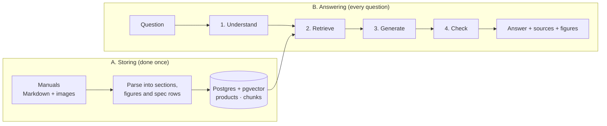
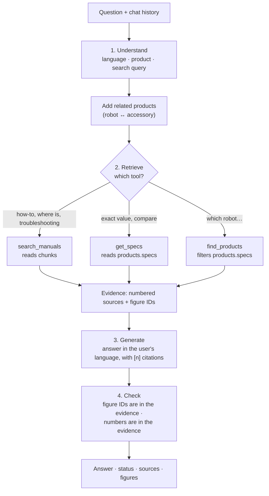

# RAG Architecture and Database Design

> How the system stores the manuals and how it answers a question.
> Frontend and backend API are not covered here. For the full plan see [6_project_plan.md](./6_project_plan.md).

---

## 1. The idea in short

The manuals are stored in two forms:

- **Text and figures**, cut into sections, so the system can find and quote the right passage.
- **Specifications**, as structured values per product, so the system can look up and compare numbers without guessing.

When a question arrives, the system first works out **which product** it is about, then fetches the evidence, then writes an answer that uses **only that evidence** and cites it.



---

## 2. The database

One PostgreSQL database with the `pgvector` extension. Two tables.

| Table | One row is | Rows | Used for |
|---|---|---|---|
| `products` | one product (robot or accessory) | 22 | Product names and aliases, specifications, links between robots and accessories |
| `chunks` | one numbered section of a manual, in one language | about 1,000 | Finding and quoting text; returning figures |

### 2.1 `products`

| Column | Example | Purpose |
|---|---|---|
| `id` | `bellabot-pro` | Key used everywhere |
| `name` | BellaBot Pro | Shown to the user |
| `kind` | `robot` | `robot` or `accessory` |
| `family` | `delivery` | Lets "which delivery robot…" ignore cleaning robots |
| `aliases` | `["Bella Pro"]` | Other names users may type |
| `langs` | `["en","de","it"]` | Languages the manual exists in |
| `related_products` | `["charging-station-light"]` | Accessories of a robot, or robots of an accessory |
| `overview` | `{"en": "BellaBot Pro is an indoor delivery robot…"}` | First overview paragraph, quoted from the manual |
| `specs` | see below | All specification values |

`specs` is JSON. Each parameter holds a **list**, because one parameter can have more than one printed value:

```json
{
  "min_passage_width": [
    {"raw": "65 cm", "label": "Min. travel width",
     "min": 65, "max": 65, "unit": "cm", "op": "=",
     "page": 3, "pdf_page": 4, "reviewed": true}
  ],
  "battery_runtime": [
    {"raw": "11 h (unloaded)", "label": "Battery life", "condition": "unloaded",
     "min": 11, "max": 11, "unit": "h", "op": "=",
     "page": 3, "pdf_page": 4, "reviewed": true}
  ]
}
```

- `raw` is the value exactly as printed. The answer quotes this.
- `min`, `max`, `unit` are the same value as numbers, in one unit per parameter, so products can be compared.
- `reviewed` is `true` when a person has checked the entry against the manual. Comparisons and rankings use only reviewed entries.

A new product with different specifications is just a new row with its own keys. The table does not change.

### 2.2 `chunks`

| Column | Example | Purpose |
|---|---|---|
| `product_id` | `bellabot-pro` | Filter by product |
| `lang` | `en` | Filter by language |
| `section_key` | `2.3` | Section number in the manual; used in the citation |
| `section_title` | Appearance & components | Shown in the citation |
| `section_kind` | `components` | Lets search skip legal boilerplate (`compliance`, `warranty`) |
| `block_type` | `text` or `table` | Whether the section is mainly prose or a table |
| `seq` | `7` | Order inside the manual |
| `page`, `pdf_page` | `2`, `3` | Printed page and page in the original PDF |
| `content` | the section text, including figure descriptions and label lists | What is searched, quoted and shown as the source |
| `figures` | see below | The figures that appear in this section (0 to 3) |
| `embedding` | vector | Search by meaning |
| `search_tsv` | keyword index | Search by exact words (model names, "IP20", "LoRa") |

`figures` is JSON:

```json
[{"id": "bellabot-pro:en:p003R-fig01",
  "path": "images/en-p003R-fig01.png",
  "caption": "2.3 Appearance & components",
  "labels": [{"n": "8", "text": "Lidar"}, {"n": "20", "text": "Emergency stop switch"}]}]
```

---

## 3. Design rules

| Rule | Reason |
|---|---|
| **One section = one chunk = one row.** No fixed-size splitting, no separate rows for figures | Tables and step-by-step procedures stay whole. A figure stays with the text that explains it |
| **Product first, search second** | BellaBot and BellaBot Pro share most of their text. Searching all manuals at once mixes them up |
| **If the product is known, read its whole manual** | One manual is only 3–8k tokens. This avoids search mistakes |
| **Numbers are copied from `raw`, never generated** | A wrong number is the worst possible error for a technician |
| **Figures are data.** The model picks a figure ID from the evidence; it never writes a file path | No invented or wrong images |
| **Every statement has a citation** to product, section and page | Faithfulness to the source |
| **If the evidence does not contain the answer, say so** | The manuals have no prices, availability or delivery times |
| **Manuals are stored in EN, DE and IT** | A German question is answered from the German manual when it exists, otherwise from the English one |

---

## 4. Flow A: how a document is stored

Example: the English BellaBot Pro manual, `manuals/BellaBot_Pro_User_Manual-multilanguage/en.md`.

### Step 1: Read the file

The parser reads the header (title, language), the page markers and the numbered headings. This part of the manual:

```markdown
*Page 2 (PDF page 3, right)*

## 2.3 Appearance & components


> *Figure description (AI):* The figure shows the locations of all product components with numbered labels. …

*Labels:*
- **1** LCD screen
- **2** Power switch
- **8** Lidar
- **20** Emergency stop switch

---

*Page 3 (PDF page 4, left)*

# 2.4 Specifications

| Feature | Description |
|---|---|
| Battery capacity | 25.6 Ah |
| Battery life | 11 h (unloaded) |
| Min. travel width | 65 cm |
```

becomes two sections: `2.3` (page 2, PDF page 3) and `2.4` (page 3, PDF page 4).

### Step 2: Write the `chunks` rows

One row per section:

| product_id | lang | section_key | block_type | page | content | figures |
|---|---|---|---|---|---|---|
| bellabot-pro | en | 2.3 | text | 2 | "Appearance & components. Figure description (AI): … Labels: 1 LCD screen, 2 Power switch, … 8 Lidar, … 20 Emergency stop switch" | `[bellabot-pro:en:p003R-fig01]` with its labels |
| bellabot-pro | en | 2.4 | table | 3 | the specifications table as printed | `[]` |

The figure does not get a row of its own. Its description and labels are already part of the section text, so a question like "where is the lidar" finds section 2.3, and the figure comes with it in the `figures` column.

### Step 3: Create the embeddings

For each row, the text `BellaBot Pro > 2.3 Appearance & components` + `content` is sent to the embedding model. The vector is saved in `embedding`. The product and section name are added so that similar sections of different robots get different vectors.

### Step 4: Fill `products.specs`

Each row of the specifications table is matched to a standard parameter name using a list of synonyms:

| Label in the manual | Standard parameter |
|---|---|
| Min. travel width · Min. path clearance · Minimum passing width | `min_passage_width` |
| Battery life · Runtime · Operation time of batteries | `battery_runtime` |

So `| Min. travel width | 65 cm |` becomes the `min_passage_width` entry shown in section 2.1. Labels that are not in the list are kept as they are, in an `_unmapped` list.

### Step 5: Review

A person checks the 12 parameters used for comparisons (passage width, load, runtime, charging time, weight, …) against the manual and sets `reviewed: true`. This is needed because some tables in the data are broken or use different units.

The same steps run for `de.md` and `it.md`, and for all 22 manuals.

---

## 5. Flow B: how a question is answered



| Step | What happens | Uses |
|---|---|---|
| **1. Understand** | Detect the language. Turn a follow-up ("and how long does it charge?") into a full question. Find the product by alias; if none matches, ask the LLM. Add the related products | One LLM call + `products` |
| **2. Retrieve** | The LLM chooses one or more of three tools (at most 3 calls) | `chunks`, `products.specs` |
| **3. Generate** | The LLM writes the answer from the evidence only, and names the figures to show | One LLM call |
| **4. Check** | Code removes unknown figure IDs and verifies that every number in the answer appears in the evidence | No LLM call |

The three tools:

| Tool | What it returns |
|---|---|
| `search_manuals(query, product_ids, lang)` | If 1–2 products are known: all sections of their manuals. If no product is known: the 8 best sections from vector + keyword search |
| `get_specs(product_ids, parameters)` | The spec entries of those products, with `raw` value and page |
| `find_products(parameter, op, value, family)` | The products whose reviewed spec entries match a condition |

### Example 1: a "where is" question (text + figure)

> **Question:** "Where is the emergency stop on the BellaBot Pro?"

**1. Understand**

```json
{"language": "en", "product_ids": ["bellabot-pro"], "search_query": "emergency stop switch location"}
```

"BellaBot Pro" is found by alias. No LLM guess is needed for the product.

**2. Retrieve.** The agent calls `search_manuals`. One product is known, so the tool returns the sections of the BellaBot Pro manual in English. The relevant source is:

```
[1] BellaBot Pro · 2.3 Appearance & components · page 2
    Labels: … 19 Upward facing sensor · 20 Emergency stop switch · 21 Lightning button
    Figure: bellabot-pro:en:p003R-fig01 (component overview, labels 1–21)
```

**3. Generate**

```json
{"answer": "The emergency stop switch is number 20 in the component overview, in the top view of the robot. [1]",
 "status": "answered",
 "figure_ids": ["bellabot-pro:en:p003R-fig01"]}
```

**4. Check.** The figure ID is in the evidence, so it is kept. The number 20 appears in source [1].

**Result:** the answer, one citation (BellaBot Pro, §2.3, page 2) and the component drawing with label 20 highlighted.

### Example 2: a "which robot" question in German (specs)

> **Question:** "Welcher Lieferroboter passt durch einen 60 cm breiten Gang?"

**1. Understand**

```json
{"language": "de", "product_ids": [], "family": "delivery",
 "search_query": "minimum passage width 60 cm"}
```

**2. Retrieve.** No product is named, and the question is a filter on a number. The agent calls:

```
find_products(parameter="min_passage_width", op="<=", value=60, family="delivery")
```

The tool reads the 22 product rows and keeps the reviewed entries that match:

| Product | raw | Source |
|---|---|---|
| KettyBot | 55 cm | KettyBot · 2.4 Specifications |
| KettyBot Pro | 55 cm | KettyBot Pro · 2.4 Specifications |

The T300 (60 cm) is not returned because its family is `industrial`. BellaBot (70 cm) and SwiftBot (80 cm) do not match.

**3. Generate.** The answer is written in German and the values are copied from `raw`:

> "Durch einen 60 cm breiten Gang passen **KettyBot** und **KettyBot Pro**: beide benötigen eine Durchfahrtsbreite von mindestens 55 cm. [1][2]"

**4. Check.** "55" appears in both sources. No figure was requested.

Vector search alone could not answer this reliably: it would need the specification tables of all 13 robots among its top results.

### Example 3: the answer is not in the manuals

> **Question:** "How much does the CC1 cost?"

`search_manuals` returns the CC1 manual. Nothing in it mentions a price. The model must answer with `status: "not_in_docs"`:

> "The documentation does not contain prices for the CC1."

---

## 6. Models

| Role | Used in | Note |
|---|---|---|
| Embedding model | Storing chunks; searching when no product is known | Must handle English, German and Italian. Its vector size sets the size of the `embedding` column |
| Chat model | Understand, tool choice, Generate | Must support tool calling and structured (JSON) output |

Both model names are set in the configuration, not in the code.
