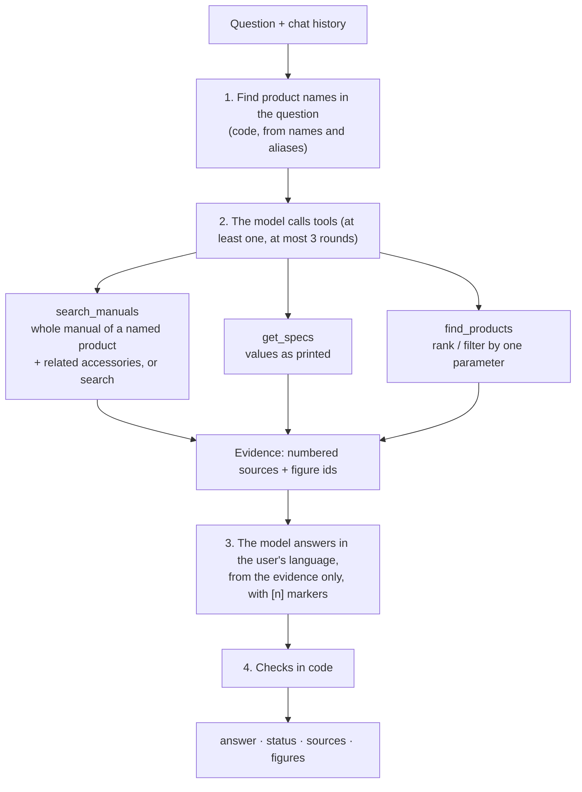

# Progress: RAG Engine

> What is built and tested after the data layer ([8_progress_data_layer.md](./8_progress_data_layer.md)).
> Branch: `ingestion-db-embeddings`. How to run: [rag/README.md](../rag/README.md).

---

## 1. Status

| Part | Status |
|---|---|
| Database, sections, figures, embeddings, specs | Done ([doc 8](./8_progress_data_layer.md)) |
| RAG engine: question → grounded answer with citations and figures | **Done** |
| Test set of 25 questions with automatic checks | **Done, 25 of 25 pass** |
| Connection to the backend API (`backend-api` branch) | Not done: next step |
| Web interface | Not started |
| Product summaries written by an LLM | Not started (optional) |

---

## 2. What the engine does

One function, `rag.pipeline.answer(question, history, lang, product_ids)`. It returns the answer text, a status, the cited sources and the figures to show.



| Step | Detail |
|---|---|
| **1. Product names** | Matched in code, longest name first, so "BellaBot Pro" is never also "BellaBot". Products chosen in the interface take priority |
| **2. Tools** | `search_manuals` reads the whole manual when one or two products are known (a manual is 3–8k tokens), plus the most relevant sections of related accessories. With no product it searches all manuals by meaning and by exact words. `get_specs` and `find_products` read `products.specs`; `find_products` uses reviewed values only |
| **3. Answer** | In the language of the question. Every statement carries a source number. Values are copied as printed. The model also returns the ids of figures worth showing |
| **4. Checks** | Figure ids not in the evidence are dropped. Source numbers are renumbered to the cited sources. Every number in the answer must appear in the evidence: one retry if not, then listed in `debug.unsupported_numbers`. An answer with no source becomes `not_in_docs` |

Status values: `answered`, `not_in_docs`, `needs_clarification`.

The model sees the product catalog (22 products with their one-line overview) in its instructions, and the main rules: use only tool results, never convert or calculate values, say which model or condition a value applies to, treat a product missing from a compatibility list as "not listed" and not as "incompatible", add no advice that is not in the manuals.

---

## 3. Example

```
> python -m rag.ask "Where is the emergency stop on the BellaBot Pro?"

The emergency stop switch on the BellaBot Pro is labeled as part 20 in the component diagram.
To stop the robot in an emergency, press the emergency stop switch. To resume operation, rotate
the emergency stop switch clockwise, tap on the screen, or press the lightning button [1][2].

status: answered · language: en
  [1] BellaBot Pro · 2.3 Appearance & components · p.2 (en)
        figure: images/en-p003R-fig01.png  (21 labels)
  [2] BellaBot Pro · 3.2 Instructions for buttons · p.4 (en)
```

---

## 4. Test results

`eval/questions.json` holds 25 questions with the expected products, values, figure and status. `eval/run_eval.py` runs them and checks each answer. The last three full runs passed 25 of 25, at about 4 seconds per answer (slowest about 6 seconds).

| Type | Questions | Example | Answer |
|---|---|---|---|
| Spec lookup | 4 | "What is the battery capacity of the BellaBot Pro?" | 25.6 Ah, cites §2.4 |
| Comparison | 2 | "Difference in battery life between BellaBot and BellaBot Pro?" | 12–24 h vs 11 h (unloaded) |
| Which robot | 3 | "Which delivery robot can pass through a 60 cm wide aisle?" | KettyBot and KettyBot Pro, 55 cm |
| Troubleshooting, how-to | 2 | "Charging Station Light is flashing yellow and does not charge" | The two causes from §3.4 |
| Compatibility | 2 | "Which charging station adapter should I use for the KettyBot?" | Found in the Charging Station Light manual, §3.2 |
| Figure expected | 3 | "Where is the lidar on the T300?" | Part 5, with the component figure |
| No figure expected | 1 | "What is the charging time of the HolaBot?" | 4.5 h, no figure |
| German | 2 | "Welcher Lieferroboter passt durch einen 60 cm breiten Gang?" | German answer, German sources |
| Italian | 2 | "Quanto dura la batteria del FlashBot?" (no Italian manual) | Italian answer from the English manual |
| Other language | 1 | "Quelle est la charge maximale du T300 ?" | French answer, 300 kg |
| Follow-up | 1 | "And how long does it take to charge?" after a T300 question | About 2 h (from 0% to 90%) |
| Not in the manuals | 2 | "How much does the CC1 cost?" | Says the manuals do not contain it |

The checks are on products cited, values present, figure returned, language and status. They do not check the exact wording, which varies a little between runs.

---

## 5. Problems found while testing, and the fix

| Problem | Fix |
|---|---|
| On one run the model answered a follow-up question without searching, and said the value was not in the manuals | The first round now forces a tool call |
| For "where is the lidar" the model described a position it cannot see ("below the LCD screen") | The instructions now ask for the label number only |
| The model added generic advice ("contact Pudu support") | The instructions forbid advice that is not in the sources |
| A status word leaked into the answer text ("[not_in_docs]") | Removed in code |

---

## 6. Limits

- **Model:** `gpt-4.1`, set by `CHAT_MODEL` in `.env`. Chosen for speed and reliable tool use. Newer models were not tried.
- **Unsupported numbers are reported, not blocked.** After one retry they are listed in `debug.unsupported_numbers`.
- **The clarifying-question path is not tested.** No test question makes the engine ask which model is meant.
- **Spec values come from the English manuals.** For a German or Italian question the cited section is the one in the user's language, but the value text is the English one (for example "25.6 Ah", not "25,6 Ah").
- **Not connected to the backend yet.** The return format follows the contract in [6_project_plan.md](./6_project_plan.md), section 5.2, but the two have not been run together.
- **No streaming.** The answer is returned in one piece.

---

## 7. Next steps

1. **Merge with `backend-api`.** The two branches have no common history: `git merge --allow-unrelated-histories`. `backend/app/manuals.py` and `shared/products.json` are identical on both sides.
2. **Plug the engine into the backend:** `RAG_ENGINE=python`, `RAG_PYTHON=rag.pipeline:answer`, `RAG_PYTHON_SEARCH=rag.pipeline:search`, and `DATA_DIR` pointing to `data/PUDU-PDF-MD`.
3. **Small backend changes** from the project plan, section 5.3: use the `figures` of each source instead of all images of the section, and pass `status` and `language` to the interface.
4. **Web interface:** chat, source cards, figure with its label list.
5. Optional: product summaries, a human read-through of the spec table (`python ingest/load_specs.py --dry-run`).
